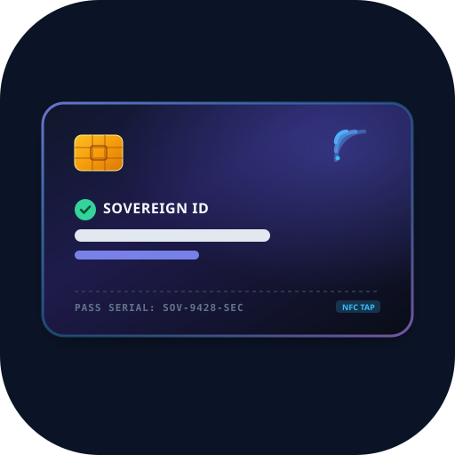

# Sovereign ID — Digital Business Card & Google Wallet Pass



**Sovereign ID** is a high-performance, single-credential digital business identity application built with React 19, TypeScript, Vite, Tailwind CSS, and **Capacitor**. It enables professionals to create, customize, and instantly distribute a secure digital business card across web, mobile, NFC tap-to-share, and **Google Wallet**.

---

## 🌟 Key Features

### 1. 💳 3D Interactive Credential Card
- **Physics & Motion**: Real-time 3D tilt responsiveness to cursor movement and touchscreen drag.
- **Card Flip Action**: Smooth 180° flip revealing an offline scannable vCard QR code.
- **Visual Credential Details**: Metallic specular reflections, company logo container, corporate ID node, and verified issuer status.

### 2. 💼 Comprehensive Business Card Setup
- **Personal Details**: Full name, professional job title, direct phone number, work email.
- **Organization Matrix**: Company name, department/division, corporate office address, tax/registration ID.
- **Custom Logo Branding**: Instant upload and client-side processing of company logos.

### 3. 📱 Google Wallet Integration
- **Direct Save to Google Wallet**: Seamlessly push your digital credential into Google Wallet.
- **Google Wallet Generic Pass API Standard**: Generates compliant `GenericObject` and `GenericClass` payloads with corporate headers, cardholder info, and embedded QR barcode.
- **Pass JSON Exporter**: Export complete Google Wallet JSON pass structures for issuer deployment and integration testing.
- **Google Wallet Pass Visualizer**: Live mockup of the Android lockscreen and Wallet pass container with NFC ISO 14443 status indicators.

### 4. ⚡ Android NFC Beam & Quick Share Protocol
- **NFC AirBeam Simulation**: Broadcast digital card link and vCard file via Web NFC (`NDEFReader`) or touch beam.
- **Quick Share & Nearby Share**: One-tap dispatch over Android system share sheets, email, and SMS.
- **Selective Field Redaction**: Toggle visibility of sensitive fields (Direct Phone, Work Email, Office Address, Tax ID) on the fly prior to sharing.

### 5. 📱 Cross-Platform Mobile Native with Capacitor
- Integrated **Capacitor 7** setup for building native Android and iOS applications directly from the Vite web build.

---

## 🛠 Tech Stack

- **Framework**: React 19 + Vite 8 + TypeScript
- **Styling**: Tailwind CSS v4 + Google Material Symbols
- **Mobile Native Bridge**: Capacitor (`@capacitor/core`, `@capacitor/android`, `@capacitor/ios`, `@capacitor/cli`)
- **Animations**: CSS 3D Transforms, Motion
- **QR Code Engine**: `qrcode.react`
- **Iconography**: Custom SVG Card Icon + Material Symbols Outlined

---

## 🚀 Quick Start

### Prerequisites
- Node.js v20+ or Node v22+
- npm 10+

### Installation & Local Development

1. **Clone the repository**:
   ```bash
   git clone https://github.com/your-org/sharable-business-card.git
   cd sharable-business-card
   ```

2. **Install dependencies**:
   ```bash
   npm install --legacy-peer-deps
   ```

3. **Start the local development server**:
   ```bash
   npm run dev
   ```
   The application will run locally at `http://localhost:3000`.

---

## 📲 Capacitor & Android Build

To build and run Sovereign ID as a native Android app:

1. **Build the production web distribution**:
   ```bash
   npm run build
   ```

2. **Sync web assets to Capacitor native Android platform**:
   ```bash
   npx cap sync android
   ```

3. **Open in Android Studio**:
   ```bash
   npx cap open android
   ```

4. **Run on Android Emulator or Device**:
   Build and launch directly from Android Studio or run:
   ```bash
   npx cap run android
   ```

---

## 💳 Google Wallet Integration Details

Sovereign ID formats your digital business card into standard Google Wallet `GenericObject` and `GenericClass` structures.

### Pass Payload Architecture
- **Issuer ID**: Configurable via `VITE_GOOGLE_WALLET_ISSUER_ID` in `.env`.
- **Pass ID**: `ISSUER_ID.SOV-xxxx-xx`
- **Pass Class**: `ISSUER_ID.sovereign_business_card_v1`
- **Barcode**: Embedded vCard 3.0 QR code scannable directly by Google Wallet.
- **Text Modules**: Contains Company Name, Department, Work Email, Phone, and Office Address.

### Triggering Pass Save
- Click **Add to Google Wallet** in the Wallet modal or **Open Google Wallet** in the Wallet Sync tab.
- Developers can click **Export JSON** to inspect or upload the generated Google Wallet Pass schema to the Google Pay & Wallet Console.

---

## 📁 Directory Structure

```
sharable-business-card/
├── android/                   # Capacitor Native Android Project
├── public/
│   ├── card-icon.svg          # Smart Business Card Icon SVG
│   └── favicon.svg
├── src/
│   ├── assets/                # Default image assets
│   ├── components/
│   │   ├── BootSetupScreen.tsx    # Initial business card setup onboarding
│   │   ├── BottomNav.tsx          # Mobile navigation bar
│   │   ├── CardDetailsTab.tsx     # Card & company configuration tab
│   │   ├── CompanyLogoUploader.tsx# Logo upload & preview component
│   │   ├── InteractiveCard3D.tsx  # 3D tilt card & scannable QR flip
│   │   ├── NfcBroadcastView.tsx   # NFC AirBeam & Quick Share modal
│   │   ├── ShareSheetModal.tsx    # System share sheet modal
│   │   ├── ShareTab.tsx           # Main identity & share workspace
│   │   ├── TopBar.tsx             # Header bar with tab navigation
│   │   ├── WalletPassModal.tsx    # Google Wallet Pass scannable modal
│   │   └── WalletSyncTab.tsx      # Wallet sync settings & visualizer
│   ├── data/
│   │   └── defaults.ts        # Default card profile factory
│   ├── types/
│   │   └── card.ts            # TypeScript interfaces
│   ├── utils/
│   │   ├── googleWallet.ts    # Google Wallet pass builder & launcher
│   │   ├── image.ts           # Canvas image processor & optimizer
│   │   └── vcard.ts           # vCard 3.0 generator & downloader
│   ├── App.tsx                # Main app state manager
│   ├── index.css              # Custom styling & Tailwind imports
│   └── main.tsx               # App entry point
├── capacitor.config.ts        # Capacitor configuration
├── index.html                 # HTML shell with card favicon link
├── package.json               # Project manifest & scripts
├── tsconfig.json              # TypeScript configuration
└── vite.config.ts             # Vite build configuration
```

---

## 📄 License

MIT License. Designed & developed for seamless digital identity sharing on Android & Web.
